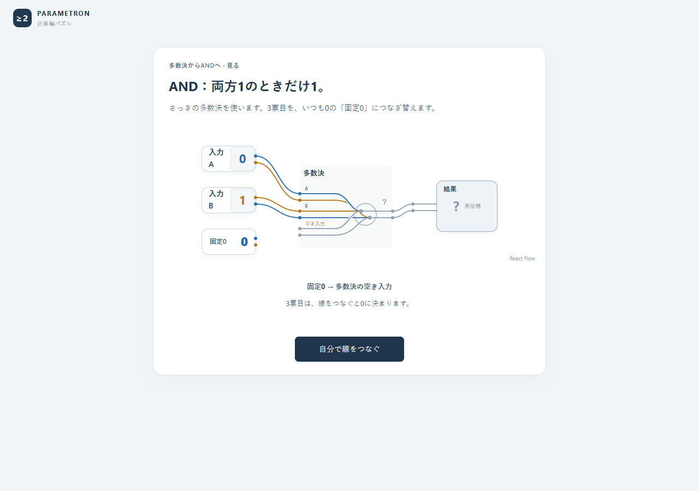
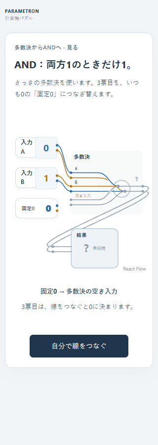
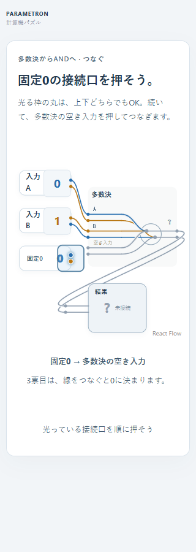
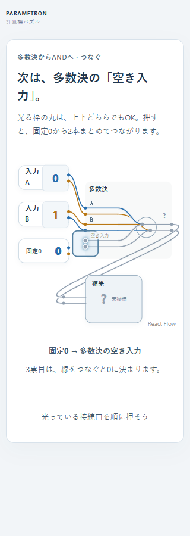
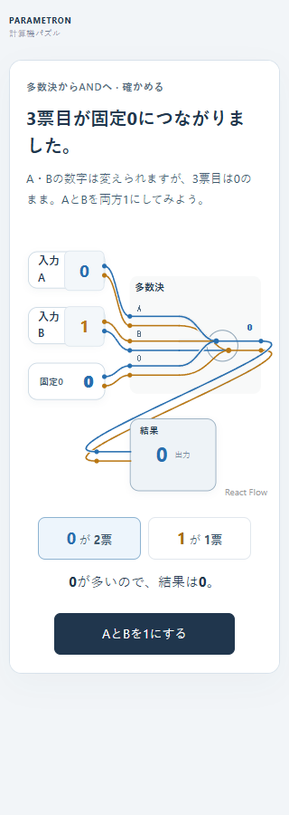
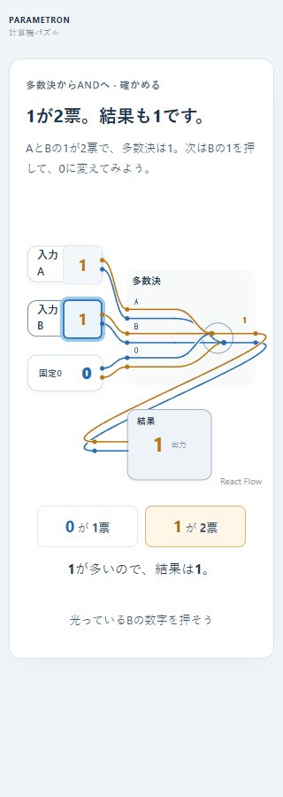
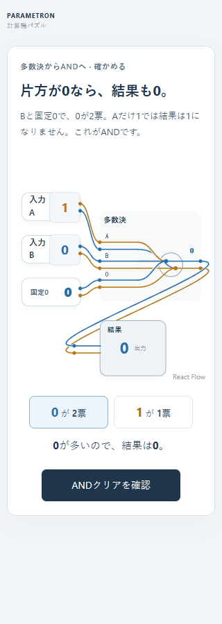
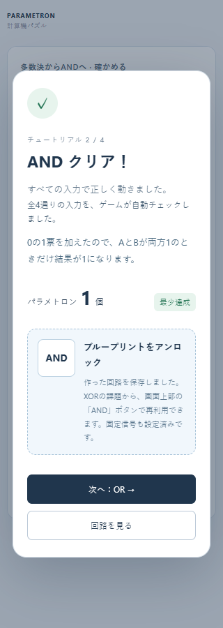

# AND導入の修正と、事前説明なしの再レビュー

2026-11-14。[修正前のレビュー](and-transition.md)で見つかった多数決→ANDの断絶を修正した。下の画面は今回の修正版を独立ヘッドレスEdgeで操作・撮影し、保存した画像を確認したもの。

## 修正した流れ

1. **見る：前の回路との関係を説明。** 多数決と同じ小さな枠と配置を使い、部品名「多数決」、出力名「結果」を維持する。A・Bの数字も直前から引き継ぐ。「AND＝両方1のときだけ1」「さっきの多数決の3票目を固定0につなぎ替える」と説明する。固定1や編集用ツールはこの段階では出さない。

2. **つなぐ：二つの接続口を順に押す。** 「自分で線をつなぐ」から操作へ進み、固定0→多数決の空き入力の順に、2本まとめた接続口を一つずつ強調する。上下どちらの丸でもよいと最初から説明する。強調中の当たり範囲も広げた。

3. **試す：両方1と片方0を比較。** 接続直後にはクリアを出さない。「AとBを1にする」で1が2票になる様子を見て、次にBの1を押し、固定0と合わせて0が2票になることを確かめる。結果と票数、押す対象を同じ枠で示す。

4. **確認：比較の後でクリアと設計図を獲得。** 自分で試した入力とゲームの全入力検証を区別するため、「全4通りの入力を、ゲームが自動チェックしました」と明記した。通常プレイでは、この段階でANDの設計図を保存・アンロックする。

## 新規サブエージェントのレビュー

前回の担当とは別の新規エージェントを使い、親の会話・仕様・コード・過去レビュー・修正意図を渡さず、指定画像だけを順に見せた。各画像の注目箇所、次の具体操作、予想する結果、確信度、不明点を、次の画像を見る前に記録させた。

- **390幅の流れを見る担当：** 固定0→空き入力→両方1→片方0を追え、操作と結果の意味が結び付いていると評価した。主要な導線に重大な迷いは挙げなかった。一方、ボタンが数字を変えることや、全入力検証の主体が曖昧と指摘した。
- **320幅の開始・接続を見る担当：** 完成条件と押す順序を読み取れ、接続元・接続先とも自己申告の確信度95/100。図の固定0のラベルと説明の表記が異なる点、開始ボタンが自動実演か手動操作か分かりにくい点を指摘した。スマホの結果への配線が回り込むことも、読み取り上の課題として残った。

この2体の指摘を受け、「3票目·固定0」の表示を「固定0」に揃え、ボタンを「自分で線をつなぐ」「AとBを1にする」へ変更し、ゲームによる全4通りの自動確認を明記した。余白も調整した。

**最終版を別の3体目へ確認：** 320幅の開始からクリアまで7枚を、同じく前の会話や変更理由を渡さず順に見せた。各段階で次の操作を特定し、1が2票/0が2票になる理由、最後の自動チェックと成功表示を読み取れた。判定は「進行を止める重大な迷いは残りません」。一方、接続口の周辺が密集する点、上下の線それぞれの意味、設計図を実際に再利用する操作は未解決とした。これらを解消済みとは扱わない。

これはモデルによる画像レビューであり、回路知識のない人間の実測ではない。確信度は自己申告で、人間の成功率ではない。配線を追う読みやすさ、実機タッチやスクリーンリーダーの使用感、OR以降で自力で応用できるかは、このレビューだけでは保証しない。

## 動作の確認と復習

ローカルで`npm test`、`npm run build`、`npm run test:browser`が成功。ブラウザでは1280/390/320幅で、段階的な案内、接続口の実際の当たり範囲44px以上、接続だけではクリアしないこと、両方1/片方0の出力と票数、途中の保存復元、クリア後の設計図獲得、後続の全課題を検証した。

`?and-guide=1`から、このAND導入だけを最初から復習できる。復習では元の保存データを一切更新しない。保存済みの回路・位置・設計図・自己ベストのJSONが、復習のクリア前後で完全に同じであることも自動検証した。
