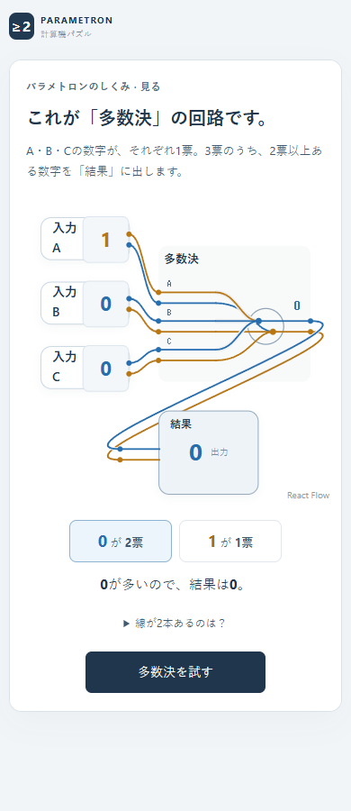
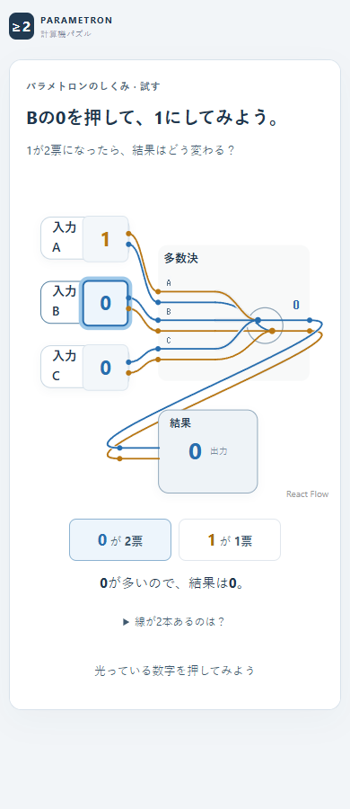
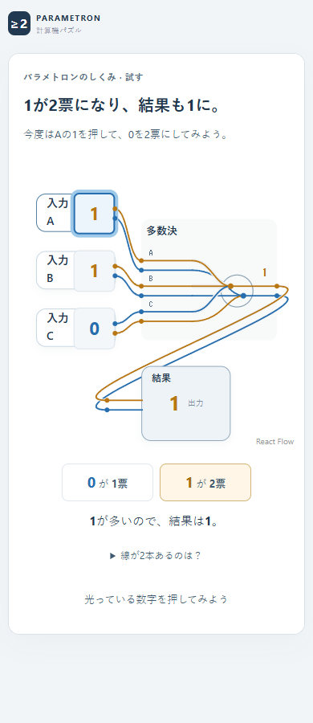
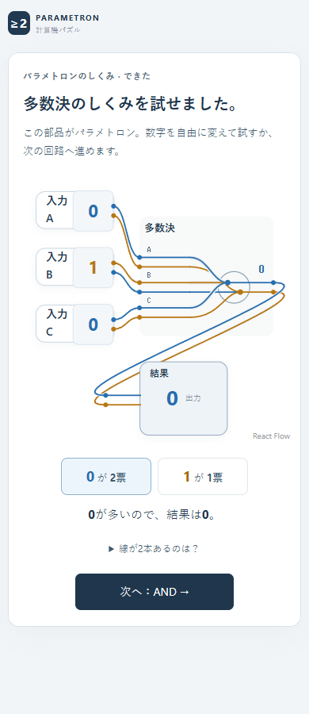
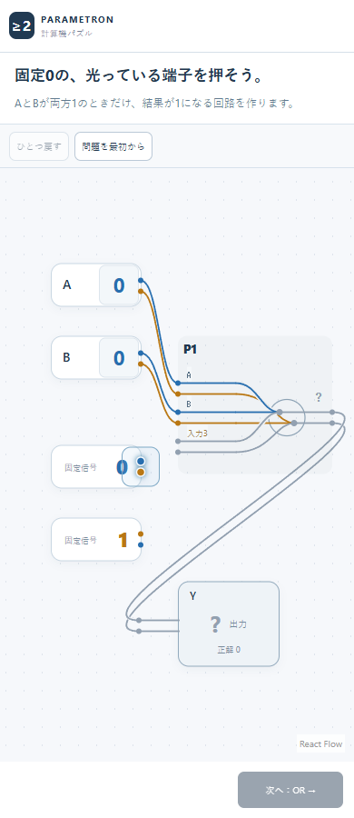
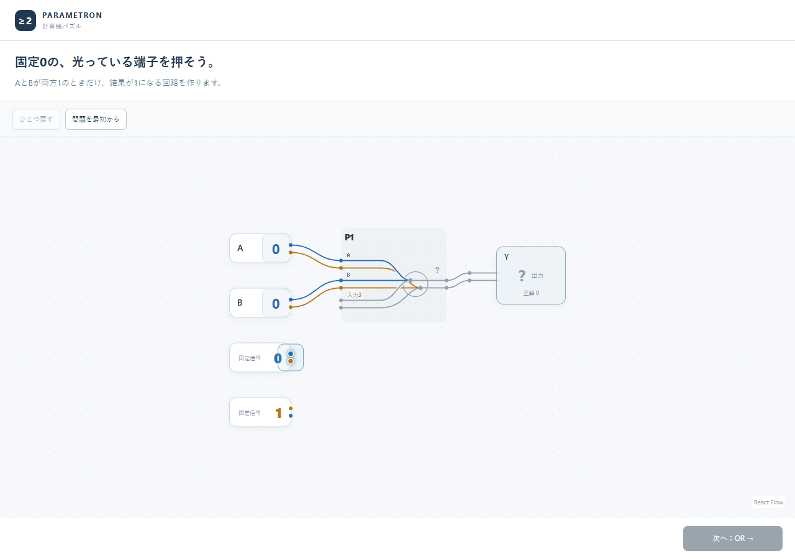
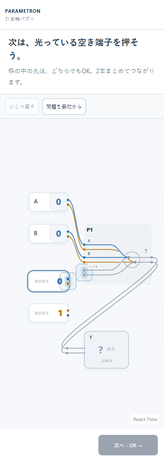
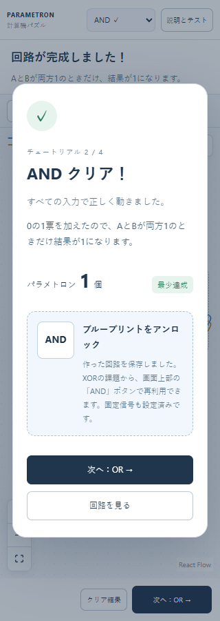

# 多数決からANDへ移る場面の初見レビュー

2026-11-14。対象は公開版コミット`46de60b8ec25473054dcc8dc841ba68eebd08864`。多数決の開始からANDの最初の接続・クリアまでを、独立したヘッドレスEdgeで操作・撮影した。PC幅1280、スマホ幅390/320、高さ900。以下の画像は今回の公開ページから取得した。

## 方法と限界

親の会話を引き継がない新規サブエージェント2体へ、画像だけを渡した。仕様、コード、README、設計意図、過去の評価、ユーザーの懸念は渡していない。回路の既知の知識で補わず、画像に書かれた情報だけを根拠に判断するよう依頼した。

- **順番に見る担当：** 390幅の多数決開始→入力操作→結果1→完了→AND開始の5枚。各画像を個別に開き、次の画像を見る前に注目箇所・目標・次の操作・確信度・不明点を記録した。
- **ANDだけを見る担当：** 最初に1280幅のAND開始画面だけを見て反応を固定し、その後320幅を確認。初見記録のあとで、最初の丸を押した後とクリア時の2枚を追加し、初見時の懸念が後の案内で解消するかを確認した。

モデルは回路知識を実際に忘れた人間ではない。これは事前文脈を与えないモデルレビューで、人間の初心者による実測ユーザーテストではない。確信度はモデルの自己申告であり、正答率や人間の成功率ではない。サブエージェントは画像を閲覧し、実操作は撮影側が行った。

## 1. 多数決を見る・試す：次の操作は明確

順番に見る担当は、開始画面で見出しと1・0・0を見て、次に「多数決を試す」を押すと判断した（自己申告95/100）。Bの操作、次のAの操作は、指示と数字の枠が対応しており、いずれも100/100だった。

線が2本ある理由や図の細部は未解決でも、次の操作と票数・結果の変化は追える。一方、完了画面の「この部品」が中央の図を指すこと、ANDという次の名前と多数決との関係はまだ分からないとした。

## 2. 多数決の完了→AND開始：意味と表示の連続性が弱い

順番に見る担当が最も立ち止まったのは、この切り替わりだった。次へボタンは押せるが、何を作る段階へ移ったのかをつなぐ説明がなく、同じ部品を使っているかも判断しにくい。

| 直前の多数決 | AND開始 | 初見で残った疑問 |
|---|---|---|
| 中央の名前は「多数決」 | 「P1」に変わる | 同じ部品なのか、新しい種類なのか |
| 出力は「結果」 | 「Y」「?」「正解0」になる | どれが現在の結果で、どれが目標なのか |
| 大きな数字を押す | 小さな「端子」を押す | なぜ数字でなく丸を押すのか、その後何をするのか |
| 小さな説明枠の中で操作する | 全面の編集画面へ変わる | 新しい表示のうち、今どこを見るべきか |
| 「次へ：AND」と予告する | ANDという見出しが見当たらない | 今の課題がANDなのか確認できない |

「AとBが両方1のときだけ、結果が1になる」という目標文は読めた。ただし、前に試した3票の多数決から、なぜ固定0を接続する課題へ移るのかは説明されていない。この**概念のつながり不足を優先度高**と評価する。単にクリック先を追加で光らせるだけでは、この問題は解決しない。

## 3. ANDの最初の一押し：探せるが、何を押すかに迷いが残る

ANDだけを見る担当は、見出しの「固定0の、光っている端子を押そう。」に最初に注目し、固定0の右側を押すと判断した。PCの一押しの確信度は70/100、続けて見たスマホ画面では65/100。上下の青・黄の丸が近く、どちらを押せばよいかは説明がないとした。

順番に見る担当も固定0の発光を探せたが、「対象」の確信度80に対して「押した後の見通し」は30だった。固定1、入力3、P1、Yの用途も不明とした。これは操作不能という実測結果ではなく、**初回の丸の扱いと操作の見通しに中程度の迷いが残る**という画像上の評価である。

## 4. 最初の丸を押した後：接続先と上下の丸の疑問は解消

追加画像を見たAND担当は、「次は、光っている空き端子を押そう。」「枠の中の丸は、どちらでもOK。2本まとめてつながります。」と、入力3付近の発光が対応すると判断した。初見時に不足とした接続先・上下どちらを押すか・何が起きるかは、この段階では分かると評価を更新した。

したがって、初見画像だけで「接続先が分からず進行不能」と断定するのは過剰である。実際には段階的な案内がある。残る問題は、最初の一押しより前には上下どちらでもよいことが分からない点と、固定0を足す意味がまだつながらない点である。

## 5. 接続完成：成功と次の操作は明確、理由の理解は未確認

追加画像の「ANDクリア！」「すべての入力で正しく動きました」と「次へ：OR」により、AND担当は成功と次の操作を判断できた。成功表示そのものが不足しているという初見時の懸念は解消した。

一方、「0の1票を加えたので、AとBが両方1のときだけ結果が1になります」は説明として読めても、なぜそうなるかの理解までは確認できないとした。撮影側も2クリックでクリアすることを確認したが、これは操作・判定の確認であり、学習の成立を証明しない。

## 修正の優先順位

1. **高：多数決とANDをつなぐ。** AND開始時に「AND＝両方1のときだけ1」「さっきの多数決の3票目を固定0につなぐ」と、名前・目標・前の回路との関係を示す。P1/Yへ一度に呼び替えず、見慣れた「多数決」「結果」を維持する。
2. **高：導入中の注目範囲を保つ。** ANDでも説明と回路を小さな同じ枠へまとめる。全面の編集画面、不要な固定1、やり直し操作などを同時に見せる必要があるか見直す。
3. **中：最初の接続操作を一文で予告する。** 例は「固定0の丸→多数決の空き入力の順に押してつなぐ」。二つの丸はどちらでもよいことを最初から伝え、2本をまとめたひとつの接続口として強調する。青い丸だけが正解であるかのような案内は避ける。
4. **理解の確認：接続後に両方1の例を見る。** クリア表示を理解の証拠にせず、0の票を加えたときに、A/Bが両方1の場合だけ1が多数になることを、入力と結果で確かめられるようにする。

優先順位は今回の画像とモデル反応を踏まえた提案であり、この報告で修正を実装・検証したという意味ではない。
