# 初回オンボーディングのレビューと修正

2026-11-14。対象は、新規アクセスから最初のAND回路の完成まで。PC（1280×900）とモバイル幅（390×900、320×900）で確認しました。

## 利用者のフィードバックを受けた再修正（現行版）

下記の初回改善案に対し、利用者から「開いた画面の情報が多すぎる」と指摘があった。初見モデルが進行できると判断したことと、実際に負担なく遊べることは同じではなかった。

現行版では、最初の画面を見出し・目的の一文・「はじめる」に絞った。数字を押す練習は次の画面に分け、まずは0を押す操作だけを出す。操作後にだけ「回路で試す」を出す。回路の案内も短くし、重複する下部案内や練習前の問題選択を隠した。

`?welcome=1` で新しい入口を直接開ける。既存の進捗がある場合は「ゲームに戻る」から復帰でき、実際の回路や自己ベストは保持する。

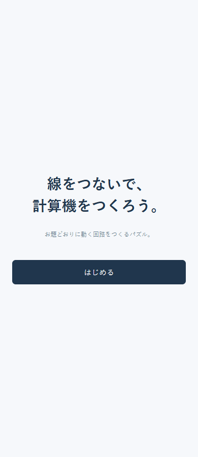
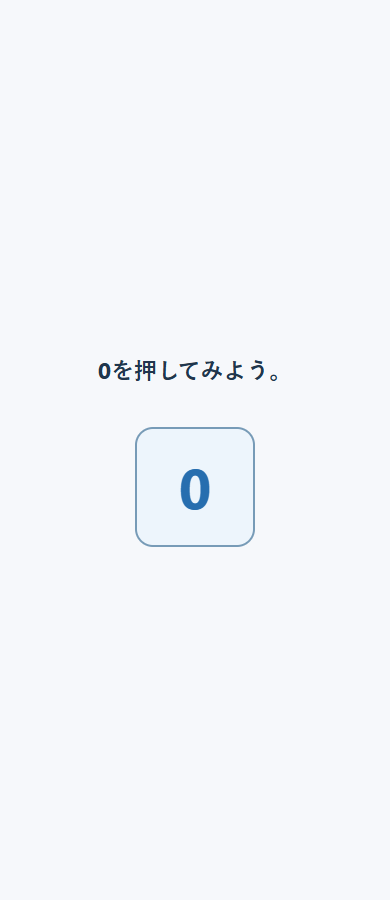

以下は、再修正前の初回レビューと改善案の記録。

## 変更前の問題

1. **入口：要改善。** ゲーム全体の目的より先に「多数決」「信号」「真理値表」が出る。完成済みの回路と全行の✅から、自分が何を完成させるゲームか分かりにくかった。
2. **モバイル：要改善。** 説明が初期表示で隠れ、説明を開くと操作対象が覆われた。
3. **最初の操作と配線：要改善。** 数字を一度も押さずに次へ進めた。ANDでは、端子の選び方と論理の理解を同時に要求していた。

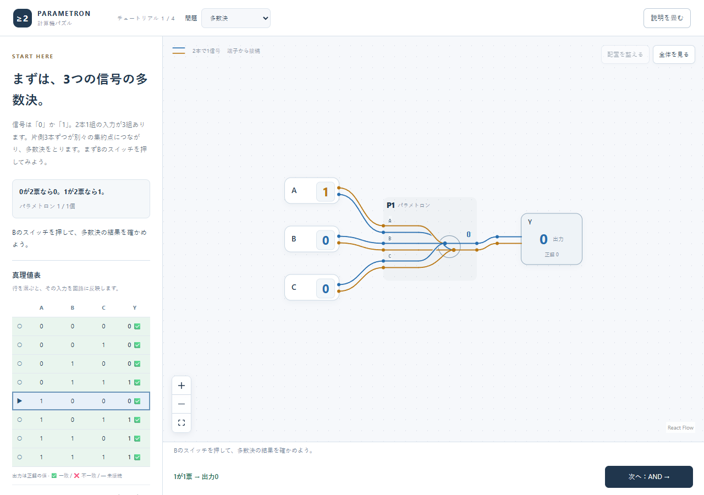

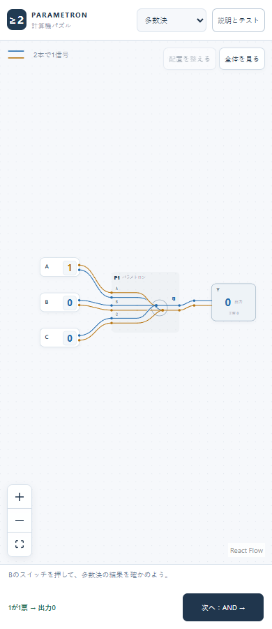

## 修正後の流れ

### 1. 目的を知る：良好

「線をつなぎ、お題どおりに動く回路を作る」という遊び方を最初に伝える。到達点として足し算の回路を示し、専門用語の説明から始めない。

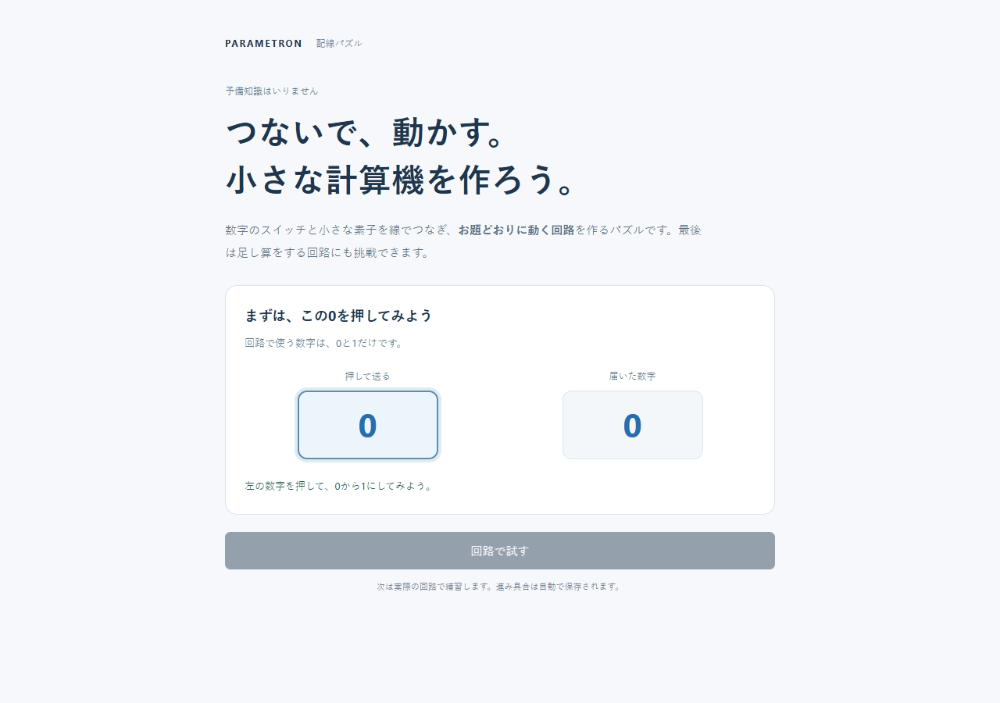

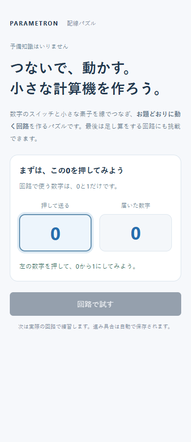

### 2. 数字を押して反応を見る：良好

大きな0を押すと入力と届く数字が1に変わる。成功文が出て「回路で試す」が有効になる。操作を試す前に次へ飛ばさない。PCではキーボードのSpace、モバイル幅ではタップでも確認した。

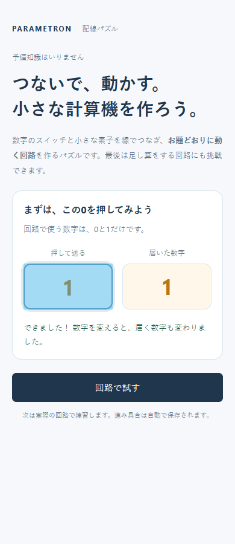

### 3. 実際の回路を動かす：良好

案内と強調されたBを同じ画面に置く。Bを押すと結果が変わり、その操作に結び付けて初めて「多数決」を説明する。成功後はAやCも自由に試せ、案内の票数も現在の入力に追従する。最初から表や編集用ツールを全部見せない。

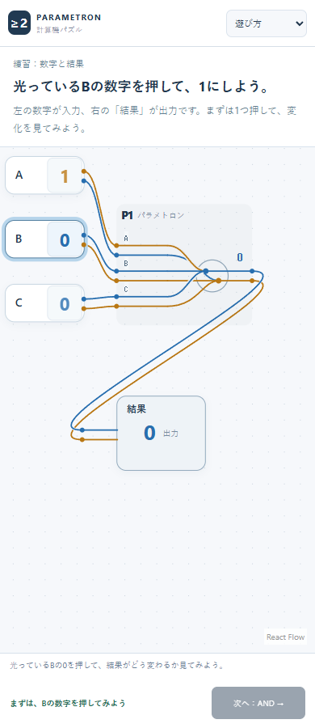
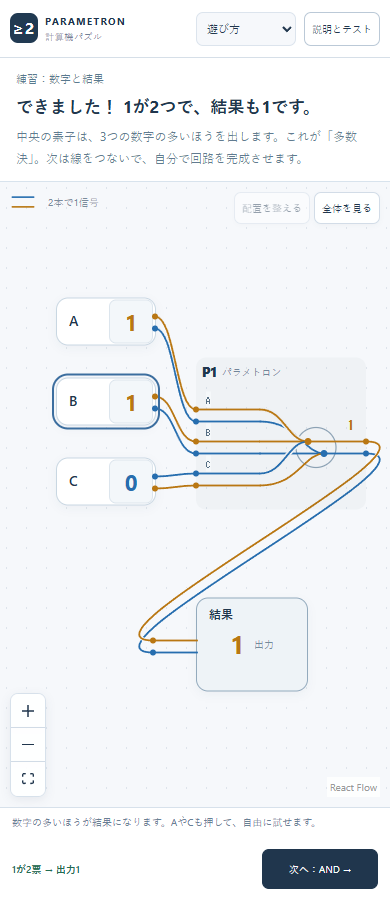

### 4. 最初の線をつなぐ：良好

先に「AとBが両方1のときだけ結果を1にする」という目的を出す。固定0の出発端子、空いている接続先の順に強調する。上下どちらの丸でも2本まとめてつながることを説明し、実際に異なる側の丸を押して接続できることを自動操作でも検証した。配線操作はReact Flow標準のまま。

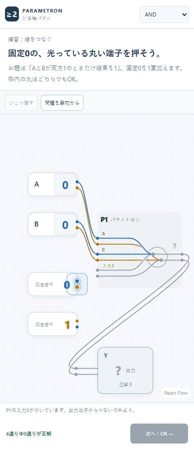
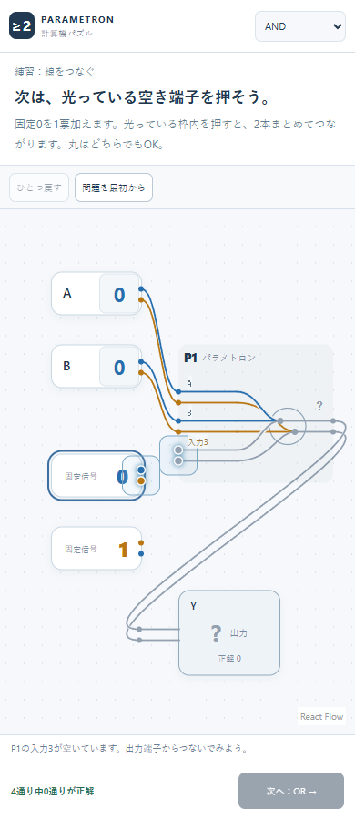

### 5. 完成の意味と次の目標を知る：良好

クリアダイアログ自体に「0を1票加えると、AとBが両方1のときだけ1になる」を置く。背後の説明を読まずに次へ進んでも意味が伝わる。ANDのブループリントが、XORの課題から画面上部のボタンで再利用できることも明記した。

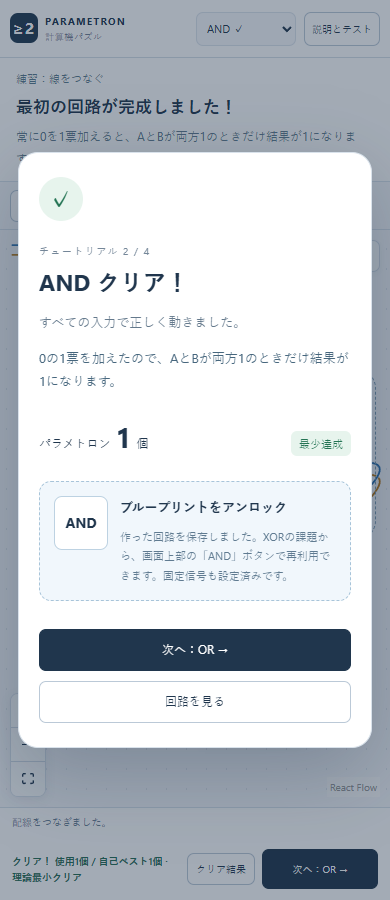

### 6. 続きから遊ぶ・導入を見直す：良好

以前の進捗がある人には導入を強制しない。問題メニューの「遊び方」で導入を開き直せ、「ゲームに戻る」で既存の回路と自己ベストを保って戻れることを操作テストで確認した。

## サブエージェントのレビュー

変更前は2体に仕様・設計意図・コードを渡さず、今回の画面だけを見せた。ゲームの目的、スマホでの説明と操作の分離、成功の区切りが共通の指摘だった。

修正版は別の初見エージェント1体と、比較レビュー1体で確認。「初回操作を止める重大な問題は画像からは確認できない」という判定だった。残った「なぜ0なのか」「説明がクリア画面の後ろに隠れる」「2つの丸のどちらを押すか」「再利用ボタンがいつ使えるか」という指摘も最終版で修正した。

これはモデルによる事前説明なしのレビューであり、人間の初心者による実測ユーザーテストではない。

## 確認できたこと・限界

- クリック、タップ、数字ボタンのキーボード操作、段階的な案内、進捗の保存・復元、全課題の既存動作を自動操作で確認した。
- 画面上で案内と対象が同時に見えること、モバイルでの収まりを撮影して確認した。
- 実機の指での押しやすさ、スクリーンリーダーでの配線操作、OR以降で自力で考えられるかは、人間での確認が残る。全面的なアクセシビリティ適合を主張するものではない。

## 設計の参考

目的・操作・期待される結果が分かる文脈をUIに与えるという [Xbox Accessibility Guideline 114](https://learn.microsoft.com/en-us/xbox/accessibility/xbox-accessibility-guidelines/114) と、操作する場面で学ぶ [Game Accessibility Guidelines: Include interactive tutorials](https://gameaccessibilityguidelines.com/include-interactive-tutorials/) を参考にした。今回のゲームでは「目的→操作→反応→意味」の順に、必要な情報を段階的に出す方針にした。
